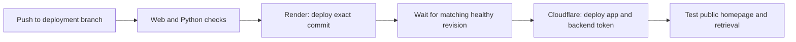

# Deploy NyayaSathi for a free hackathon demo

This guide uses **Cloudflare Workers Free** for the web app, **Render Free** for Python/BGE, and your existing **Groq Free** account for generation. GitHub Actions checks and deploys the code. No custom domain, hosted vector database or GPU is needed.

Deployment files are prepared, but that does not mean the site is online. You must finish the account/secret setup and get a successful deployment. Never paste a key or deploy-hook URL into chat, a GitHub issue, or a committed file.

## What CI/CD means here

- **CI (continuous integration):** each push/PR runs web tests, build, type checking, lint, Python tests, real embeddings, retrieval evaluation and a memory check.
- **CD (continuous deployment):** after both CI jobs pass on the configured deployment branch, GitHub deploys that commit to Render, waits for its `/health` revision, deploys the Cloudflare Worker and its private backend token, then checks the public homepage and retrieval API.
- `DEPLOY_ENABLED` must be `true`. Until then, the deployment job is intentionally skipped. PR jobs never deploy or receive these secrets.
- Public smoke tests use `useAI: false` and do not consume Groq quota. Do one manual AI test after the first deployment; `aiAvailable` indicates configuration, not proof that a provider key is valid.



## 1. Create two free accounts

1. Register at [Cloudflare](https://dash.cloudflare.com/sign-up), verify your email and open the dashboard.
2. Register at [Render](https://dashboard.render.com/register). Connecting your existing GitHub account is convenient; grant access to `vibhorchander-ai/nyayasathi` when asked.
3. Keep Cloudflare Workers Free and Render's free Hobby workspace/Free compute. Do not add a payment method, select paid compute, add a paid disk or upgrade Groq. If the flow requires payment, stop and reassess before proceeding.

These are limited free services, not unlimited production hosting. [Cloudflare limits](https://developers.cloudflare.com/workers/platform/limits/), [Render free hosting](https://render.com/docs/free), [Groq billing](https://console.groq.com/docs/billing-faqs).

## 2. Reserve the Cloudflare demo address

1. Open **Workers & Pages → Create application**. Choose a Worker/Hello World starter, name it **`nyayasathi`**, and deploy it on the Free plan. This creates a temporary starter page that CI will replace.
2. If prompted, choose your free `workers.dev` account subdomain. No domain purchase is necessary.
3. Copy the complete Worker address shown by Cloudflare, for example `https://nyayasathi.YOUR-SUBDOMAIN.workers.dev`. Use your real address, without a trailing path.
4. Copy your **Account ID** from the Cloudflare dashboard. It is a 32-character identifier, not an API token.
5. Under **My Profile → API Tokens**, create a token for deploying Workers. The **Edit Cloudflare Workers** template is a starting point; scope it to your account. The deployment needs Workers Scripts Edit and the account permissions documented by Cloudflare. Keep the token private. [Cloudflare CI setup](https://developers.cloudflare.com/workers/ci-cd/external-cicd/github-actions/).

Do not connect an additional Cloudflare automatic Git build: GitHub Actions owns this deployment. The pipeline's Worker name is `nyayasathi`; the address you provide must belong to that Worker.

## 3. Create the Render Python service

1. In Render, select **New → Blueprint** and connect the NyayaSathi GitHub repository.
2. Choose branch **`feature/initial-setup`** and Blueprint path **`render.yaml`**.
3. Confirm the proposed resource is a single **Free** Python web service called `nyayasathi-api`. There should be no database or paid disk.
4. When prompted, fill in these values privately:

   | Render variable | Value |
   | --- | --- |
   | `GROQ_API_KEY` | Your working Groq key, copied from your local private configuration |
   | `NYAYA_ALLOWED_ORIGINS` | The complete Cloudflare Worker origin from step 2 |

5. Create the Blueprint. The initial build installs Python packages, downloads the public BGE model and builds the index. One Uvicorn worker runs the app. The Blueprint generates a private **`NYAYA_API_TOKEN`** automatically.
6. Wait for **Live**, then open the service's HTTPS address followed by `/health`. Expect `status: ok`, `service: nyayasathi-python-rag` and a commit `revision`. Copy the service's root URL, such as `https://YOUR-SERVICE.onrender.com`.
7. In the service's **Environment** section, copy the generated `NYAYA_API_TOKEN` privately. GitHub needs the identical value under a different name, `NYAYA_BACKEND_TOKEN`.
8. In the service's **Settings → Deploy Hook**, copy its private deploy-hook URL. It is a credential: do not publish it.
9. Leave the service's **Auto-Deploy Off**; GitHub triggers deployment after checks. Also set the Blueprint's **Settings → Auto Sync → No** so a Blueprint edit cannot bypass CI. Apply future infrastructure changes with Manual Sync only after review and successful checks.

The generated token protects Python's `/api/*` routes; `/health` remains public. The Groq key stays only in Render. The Cloudflare Worker receives the separate backend token, not the Groq key. The existing local `.env` and `.dev.vars` are not uploaded.

## 4. Configure GitHub Actions

Open your repository's **Settings → Secrets and variables → Actions**. Repository-level secrets/variables are used by this workflow.

Under **Secrets → New repository secret**, add:

| Secret name | Copy from |
| --- | --- |
| `CLOUDFLARE_API_TOKEN` | Cloudflare token created in step 2 |
| `RENDER_DEPLOY_HOOK_URL` | Render's private deploy-hook URL |
| `NYAYA_BACKEND_TOKEN` | Render's generated `NYAYA_API_TOKEN` |

Under **Variables → New repository variable**, add:

| Variable name | Value |
| --- | --- |
| `CLOUDFLARE_ACCOUNT_ID` | Your Cloudflare account ID |
| `NYAYA_BACKEND_URL` | Your HTTPS `onrender.com` root URL |
| `NYAYA_PUBLIC_URL` | Your HTTPS `workers.dev` root URL |
| `DEPLOY_BRANCH` | `feature/initial-setup` |
| `DEPLOY_ENABLED` | `true` — set this last, when the other values are ready |

Never put a secret in the Variables tab. Do not add `GROQ_API_KEY` to GitHub: the deployment does not need it. This helper currently accepts the documented free `onrender.com` and `workers.dev` addresses; custom domains require a deliberate configuration change.

## 5. Trigger and verify the first release

After the configuration is complete, push a commit to the deployment branch. An empty commit is sufficient if you have no code changes. Run from the repository root in VS Code Terminal:

```sh
git switch feature/initial-setup
git pull --ff-only
git commit --allow-empty -m "Trigger configured free deployment"
git push origin feature/initial-setup
```

In **GitHub → Actions → Project checks**, watch `check`, `python` and then **Deploy free demo**. The deploy job first validates configuration, builds the web app, then deploys the exact tested commit. It refuses an old workflow run if the branch already points to a newer commit. Deployment jobs run one at a time.

`workflow_dispatch` is also included, but GitHub shows the **Run workflow** button only once this workflow exists on the repository's default branch. Use the push method while working on the feature branch. A skipped deployment job means `DEPLOY_ENABLED`, event or branch did not match; it does not mean the site was deployed.

When the job succeeds:

1. Open your Cloudflare URL and confirm the app loads.
2. Enable **Use AI to explain the retrieved information**.
3. Ask **How do I track my consumer grievance?**
4. Confirm **AI explanation + evidence** and open the retrieved evidence.
5. Try the URL from another browser/device. Your Mac and local terminals are no longer needed for the hosted demo.

## 6. Later releases and recovery

Push changes to the configured deployment branch. Failed checks stop deployment. If Render does not become healthy at the expected revision within 15 minutes, the frontend deployment does not start. Render and Cloudflare are two separate services, so this is not an atomic release or automatic rollback: backend changes must remain compatible with the previous frontend.

To stop automatic releases, set `DEPLOY_ENABLED=false`. For a bad application change, prefer reverting its commit and pushing the revert so both services are redeployed consistently after CI. Provider dashboards offer separate rollbacks, but verify compatibility if you roll back only one component.

When ready to deploy from `main`, first merge the reviewed work there, change `DEPLOY_BRANCH` to `main`, update Render's linked service/Blueprint branch and `render.yaml`, and manually sync the reviewed Blueprint change. A push to `main` will then run the pipeline. Do not maintain two competing deploy pipelines.

## Free-plan limits and demo preparation

- Render Free currently has 512 MB RAM and 0.1 CPU. CI measures the real BGE API process and fails above 400 MiB, leaving some headroom. This test is not a production load test or a guarantee of Render performance. [Compute plans](https://render.com/docs/compute-plans).
- Render sleeps after 15 minutes without inbound traffic. Before judging, open the backend `/health` URL, wait for it to respond, then reload the frontend. The app's short request timeout can show its source-guide fallback while Python wakes; a frontend reload refreshes availability. Do not add an artificial keep-alive schedule. [Free service lifecycle](https://render.com/docs/free).
- The model and index are built during Render's build, so normal starts can reuse the deployed files. There is no paid persistent disk; startup also checks/rebuilds stale indexes.
- Cloudflare Workers Free currently allows 100,000 requests/day and 10 ms CPU per request. HTTP wait time is separate; rendering and routing still need to fit the CPU allowance. The pipeline checks the real public homepage and API. [Workers limits](https://developers.cloudflare.com/workers/platform/limits/).
- Standard GitHub-hosted runners are free for public repositories. Private repositories have plan allowances. No stored workflow artifacts or paid runners are added here. [GitHub Actions billing](https://docs.github.com/en/billing/concepts/product-billing/github-actions).
- Groq keeps its own free quotas. The app's 100-attempt daily limit is per process and resets on restart; it is not a billing cap. Keep all accounts on free plans without a payment method.
- The local live Groq flow was verified on 14 November 2026. Public end-to-end verification is still required after account setup. The small legal corpus and retrieval limitations are unchanged.

## Troubleshooting

| Symptom | Check |
| --- | --- |
| No deployment job runs | Repository variable `DEPLOY_ENABLED=true` and correct `DEPLOY_BRANCH`; push event, not a PR |
| Render build fails or runs out of memory | Render logs, `plan: free`, Python 3.12, one worker; do not upgrade automatically |
| New backend never becomes ready | `/health` revision must equal the tested commit; check the hook belongs to this service and the build completed |
| Render returns 401 from `/api/status` | Expected in a normal browser: that route needs the private backend token |
| Worker deploy fails | Account ID, token expiry/permissions and free `workers.dev` setup |
| Public smoke test fails | Correct root URLs, matching backend token, backend awake, frontend genuinely deployed |
| AI checkbox missing | Warm backend, reload, check `GROQ_API_KEY` on Render and daily AI limit |
| AI response falls back to notes | Check Groq key/model/quota privately; CI deliberately does not make live LLM calls |

For setup help, share public service URLs and error wording only. Keep the three GitHub secrets and Groq key private.
